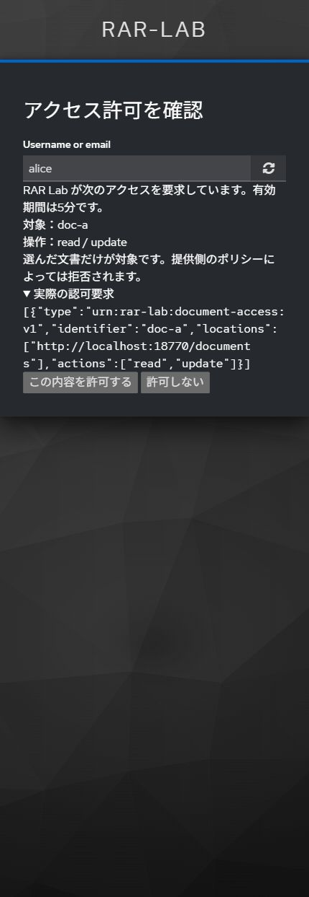
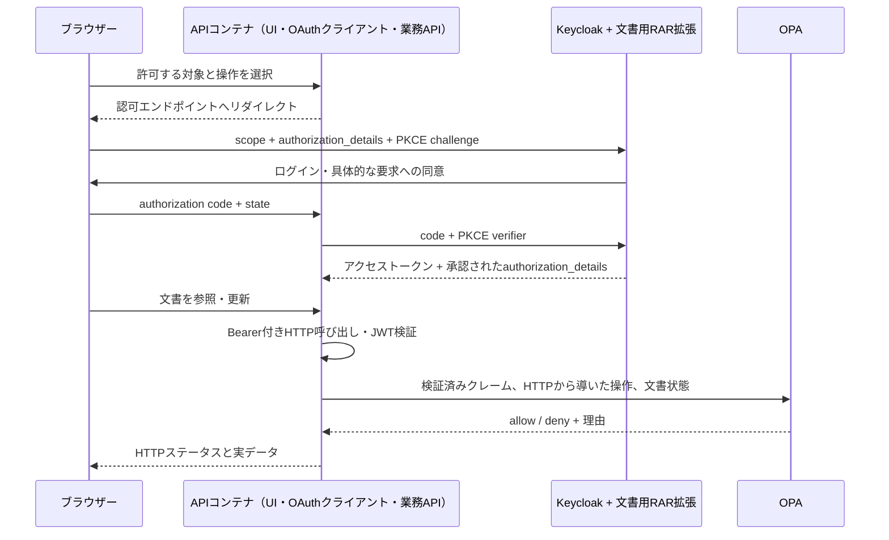

# RAR Lab — 許可の範囲を、確かめる

同じユーザー、同じscope、同じAPI。それでも「文書Aだけを更新する許可」なら、文書Bの更新は拒否される。
ブラウザーで要求・同意・トークン・APIの実行結果を追う、OAuth 2.0 Rich Authorization Requests（RAR / RFC 9396）のハンズオンです。

**RARで初めて細かな認可が可能になるわけではありません。** 独自パラメーターとJWTクレームでも同じ制御は実装できます。この実験では、詳細なアクセス要求と承認結果を `authorization_details` という標準の形式で往復させ、その内容をAPIで強制します。条件の意味と実装は、引き続き関係者間で合意します。

## まず動かす

必要なのは Git、Docker Engine + Compose v2、ブラウザー、検証用の `sh` / `curl` です。WindowsではWSL内で以下を実行してください。ChatGPTアカウントやAPIキーは不要です。

```sh
git clone https://github.com/takuma-8trees/rich-authorization-request-handson.git
cd rich-authorization-request-handson
git checkout v0.1.0
docker compose up -d --build
sh run/verify.sh
```

初回はイメージ取得とJava拡張のビルドが走ります。検証は準備完了を待ち、成功すると `PASS` を表示します。検証スクリプト自身が文書A/Bを書き換えるため、初期状態で触る場合は `docker compose restart api` で文書と画面セッションを初期化してください。

[http://localhost:18770](http://localhost:18770) を開きます。`127.0.0.1` ではなく **localhost** を使ってください。

| 項目 | 値 |
| --- | --- |
| デモユーザー | `alice` |
| デモパスワード | `alice-demo-password` |
| UI / API | `http://localhost:18770` |
| Keycloak | `http://localhost:18771` |
| トークン有効期間 | 5分。期限切れなら再取得 |

この資格情報は公開されたローカル実験専用です。実データや既存アカウントを持ち込まない構成です。

## 15分で確かめる

### 1. 要求と同意を見比べる

「① scope版を取得」を押し、デモユーザーでログインします。同意画面は「本人が扱える文書の参照・更新」です。「この内容を許可する」で戻ります。

次に対象を「文書A」、操作を「参照と更新」にして「② RAR版を取得」。もう一度ログインします。今度は **対象：doc-a、操作：read / update** と表示されます。「実際の認可要求」を開くと、承認するJSONが見えます。



許可して戻り、「要求した内容・承認された内容・トークンを見比べる」を開きます。RAR版の要求、トークンレスポンス、JWTの `authorization_details` を見比べてください。

```json
[
  {
    "type": "urn:rar-lab:document-access:v1",
    "locations": ["http://localhost:18770/documents"],
    "actions": ["read", "update"],
    "identifier": "doc-a"
  }
]
```

両トークンの `sub` と `scope` は同じです。scope版には、この `authorization_details` がありません。画面のJWT欄は署名検証済みクレームの抜粋であり、Bearerトークン文字列ではありません。

### 2. 同じAPIを呼び比べる

「呼び出しに使うトークン」を切り替え、本文を入力して更新します。

| トークン | 操作 | 期待結果 | 見るポイント |
| --- | --- | --- | --- |
| RAR版（A・参照と更新） | Aを更新 | 200 | 本文とrevisionが変わる |
| 同じRAR版 | Bを更新 | 403 | `rar_out_of_bounds`、更新なし |
| scope版 | Bを更新 | 200 | 同じscopeでも今回の許可範囲が違う |

拒否前にscope版でBを参照し、拒否後にもう一度参照すると、本文とrevisionが変わっていないことも確認できます。JSON欄には実際のHTTPリクエスト・応答が出ます。ボタン表示だけを切り替えるモックではありません。

### 3. 許可があっても、提供側は拒否できる

RAR版でAの更新が成功したあと、「文書Aを編集禁止にする」にチェックを入れます。同じトークンで「Aを更新」すると403、理由は `provider_policy_denied`。今度はRAR条件を満たしていても、提供側ポリシーが拒否しています。参照は可能です。終わったらチェックを外します。

このスイッチは、提供側の文書状態を変更する**ハンズオン専用の管理操作**です。通常の業務APIの権限管理として使うものではありません。

### 4. 条件を変える／未対応の条件を送る

- RAR版を「参照のみ」で取り直すと、Aの参照は200、更新は403になります。scopeは変わりません。
- 「もう一歩：未対応の条件を要求すると？」から未対応フィールド入りの要求を送ると、Keycloakが `invalid_authorization_details` で拒否します。条件を無視して広いトークンを発行しません。
- 同意画面で「許可しない」を押すと `access_denied`。新しいトークンは発行されません。以前取得したトークンの失効操作ではありません。

## curlでAPIを直接呼ぶ

画面の「curlでも実際のAPIを試す」から、選択したトークン付きのコマンドを表示できます。**表示したBearerトークンは共有しないでください。** WSL / bashへコピーすると `TOKEN` が設定されます。続けて次を実行できます。

```sh
# 文書Aだけを許可したRARトークンなら200
curl -i http://localhost:18770/documents/doc-a \
  -H "Authorization: Bearer $TOKEN"

# 同じトークンなら403。文書Bは更新されない
curl -i -X PATCH http://localhost:18770/documents/doc-b \
  -H "Authorization: Bearer $TOKEN" \
  -H 'Content-Type: application/json' \
  --data '{"body":"This update must be rejected"}'
unset TOKEN
```

APIは画面セッションのCookieを認可に使いません。画面内の呼び出しもサーバー側でBearer付きの実HTTPリクエストを同じAPIへ送っています。

## 3コンテナの役割



| 構成 | OSSに任せる部分 | このリポジトリで作った部分 |
| --- | --- | --- |
| Keycloak 26.8.1 | ユーザー認証、OAuth認可コード、PKCE、署名・鍵公開 | 文書用RARの検証・処理、具体的な同意画面、JWTへの反映 |
| Python / Starlette / PyJWT | HTTP受付・JWT検証の基礎 | UI、OAuthクライアント、文書API、OPA入力への変換 |
| OPA 1.9.0 | Regoの評価 | scope・RAR・提供側条件のポリシー |

Keycloakは公式イメージへJava拡張とテーマを追加してビルドします。**この文書用typeはKeycloakの標準設定だけで動くものではありません。** 内部SPIを使うため、Keycloakの版を固定しています。

UIとOAuthクライアント、業務APIは最小化のため1コンテナに同居します。OPAはDockerネットワーク内だけに公開し、ホストへポートを公開しません。外向きの2ポートは `127.0.0.1` に限定しています。Keycloakのデータは専用volume、文書・OAuthフロー・画面セッションはAPIプロセスのメモリーです。

## 標準と、このデモで決めたこと

| RFC 9396が定める部分 | この実験用プロファイルが決める部分 |
| --- | --- |
| `authorization_details` はオブジェクトの配列 | 1要素だけ対応 |
| 各要素の `type` と、共通フィールドの形式 | `urn:rar-lab:document-access:v1` の意味 |
| `locations`、`actions`、`identifier` などの共通フィールド | 文書APIのURL、`read/update`、`doc-a/doc-b` の意味と対応 |
| 認可要求・トークン応答等での受け渡し | 要求をそのまま承認するか、全体を拒否する最小実装 |
| 未対応・不正な詳細要求のエラー | 受け入れるフィールドを閉じた集合に限定 |

このデモの認可条件は **scope AND RARの範囲（存在する場合）AND 提供側ポリシー** です。RARとscopeの組合せが常にANDだとRFCが決めているわけではありません。scope版を許すのも、差分を体験するための明示的な比較設定です。

JWTには元々独自クレームを載せられます。RARが減らすのは、詳細な認可要求をOAuthにどう載せ、どう承認結果を返すかという独自プロトコル設計です。**業務上の意味の共有や、API操作から認可入力への正しい変換は残ります。** OPAはそれを実行時に評価する役割で、RARがOPAを置き換えるわけではありません。

この版にはToken Exchange、`act`、MCP、LLM、クロステナント伝播はありません。API操作はGET/PATCHに絞っています。RARそのものに集中するため、CRUD全体やエージェント委任とは切り離したハンズオンです。

## ソースを読む順番

1. `services/api/src/auth.py`：要求JSON、code + PKCE、同意後のトークン受領。
2. `services/keycloak/extension/src/main/java/local/rarlab/`：`Profile` が受け入れる意味・形、`RequestPolicy` が要求検証、`Consent` が同意、`RarProcessor` / `GrantMapper` が承認内容を応答・JWTへ渡す。
3. `services/api/src/security.py`：信頼するissuer / audience / 署名 / expとRARプロファイルの検証。
4. `services/api/src/documents.py`：HTTPメソッドから操作を導き、サーバー内の文書状態と合わせてOPAへ。許可の後にだけ更新。
5. `policies/documents.rego`：3条件と拒否理由。

## 検証・停止・初期化

```sh
sh run/verify.sh                  # OPA 7件 + JWT異常系 + 実Keycloak/APIテスト
sh run/verify-opa-offline.sh       # この構成のOPAだけ停止し、503を確認後に復旧
docker compose logs --tail 80 api keycloak opa
docker compose down              # 停止。Keycloakのvolumeは残す
docker compose up -d             # 再起動。文書と画面セッションは初期状態
```

**完全初期化が必要なときだけ**、このリポジトリのディレクトリで `docker compose down -v` を実行します。このプロジェクトのKeycloakデータ（ユーザー・鍵等）を削除します。次回 `up -d --build` でrealmを再作成します。通常の停止には `-v` を付けません。

ネットワークが重なる場合は `.env.example` を `.env` にコピーし、`RAR_SUBNET` を未使用のプライベートサブネットへ変更してください。標準値は `10.253.71.0/24`。ポートはissuer・redirect URI・文書用プロファイルのURLと連動するため、この版では固定です。起動済みの同種ハンズオンと同時に使えません。

期限切れの401はトークン再取得で解消します。realm設定ファイルの変更は既存volumeに自動反映されません。検証は文書を変更するので、他の体験者が同時利用していない状態で実行してください。

## 実測・制約・出典

[検証記録とイメージdigest](docs/VALIDATION.md)、[読み物としてのハンズオン](docs/HANDSON.md)、[依存ソフトウェアのライセンス](THIRD_PARTY_NOTICES.md)。

ローカル学習用の `start-dev` / HTTP / 公開デモユーザーです。インターネット公開や本番運用向けの構成ではありません。複数インスタンス、トークン更新・失効、PAR/JAR、詳細の縮小承認、外部のRAR実装との相互運用はこの版の検証対象外です。

- [RFC 9396](https://www.rfc-editor.org/rfc/rfc9396.html)：§2（形式）、§3.1（scopeとの関係）、§5（エラー）、§7（トークン応答）、§9（リソースサーバー）、§11（実装上の意味の合意）。
- [Keycloak 26.8.1のRAR SPI](https://github.com/keycloak/keycloak/blob/26.8.1/server-spi-private/src/main/java/org/keycloak/protocol/oidc/rar/AuthorizationDetailsProcessor.java)。
- [OPA REST API](https://www.openpolicyagent.org/docs/rest-api)。
