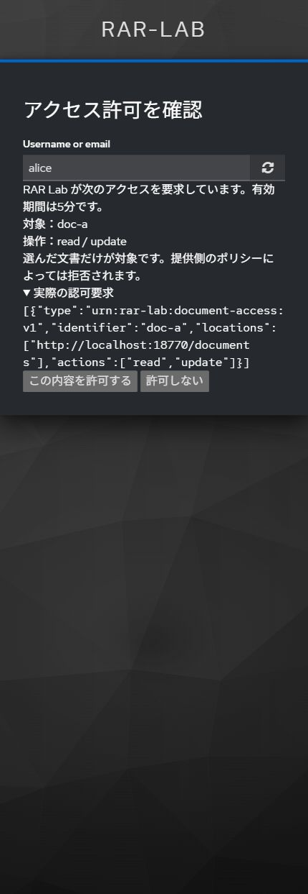

# RARは何を楽にするのか――要求からAPIの拒否までを追ってみる

「文書を更新してよい」と「この文書を更新してよい」は違います。

OAuthのscopeを `document.update` と決めたとき、それだけでは今回どの文書へのアクセスを求めているのか分かりません。アプリ側の独自パラメーターで文書IDを送り、認可サーバーで同意画面を作り、独自JWTクレームへ保存してAPIで読む。こうした実装でも、対象を限定できます。

では、RARがなくてもできることを、なぜRARでやるのでしょうか。

細かな条件を持たせることと、その条件をOAuthで要求・承認する方法を揃えることは、別の課題だからです。RARは後者に取り組む標準です。JWTの情報量を増やす機能、とだけ捉えると、要求と同意が見えなくなります。

## 自分が何を許可したかを、最初に見る

[リポジトリのREADME](../README.md#まず動かす)から3コンテナを起動します。使用するのはKeycloak、通常のHTTP API、OPA。LLMやMCPを介さず、認可要求そのものを観察します。再現版は `v0.1.0` です。

画面でscope版とRAR版を取得すると、どちらも同じaliceとしてログインします。違いはその次です。

scope版の同意画面は、本人が扱える文書の参照・更新。RAR版では、対象が `doc-a`、操作が `read / update` と具体的に表示されます。この詳細は同意画面だけの説明文ではありません。認可要求の `authorization_details` から作られています。

許可すると、アプリに認可コードが返ります。アプリはPKCEの検証情報とともにコードをKeycloakへ渡してトークンを受け取ります。画面に戻り、要求・トークンレスポンス・JWTの詳細を並べると、今回は同じ対象と操作が往復しています。

この実装は要求全体を承認するか拒否するかの二択です。RAR一般には、要求から承認内容が変わる場合もあります。「要求したから必ずその権限が発行される」という仕組みではありません。

## トークンの差が、実行結果の差になる

RAR版で文書Aを更新すると200になり、本文とrevisionが変わります。同じトークンで文書Bを更新すると403になります。scopeは同じでも、今回の許可に文書Bは含まれていません。

scope版へ切り替えて文書Bを更新すると、こちらは200です。これはRARを使わないAPIが細かい認可をできないという意味ではありません。この比較では、scope版に文書IDの制限を設けず、RAR版に今回の対象を加えています。独自の要求パラメーター・クレームでも同じ結果を作れます。

差分を作っているのは魔法のトークン形式ではなく、要求と承認内容を引き継ぎ、実際のAPI操作に照らして確認する実装です。ここではAPIが署名等を検証し、HTTPメソッドから `read/update` を導き、OPAが条件を評価します。

## それでも、トークンだけでは決まらない

画面で文書Aを編集禁止にして、同じRARトークンで更新を試します。今度は `provider_policy_denied` で403になります。RARに文書Aの更新が入っていても、提供側は現在の状態に基づいて拒否できます。

この実験は、認可サーバーが提供側のポリシーをすべてトークンへ写し込む必要がないことも示します。一方で、`doc-a` がどの文書で、`update` がどの操作なのかは両者が理解していなければなりません。その意味の合意までRARが消してくれるわけではありません。

## 共通になる部分と、残る仕事

RARでは `authorization_details` の配列、各要素の `type`、共通フィールド、OAuthメッセージ上での受け渡し方を利用できます。独自に `requested_permissions` のようなパラメーターを作り、入力形式や応答との対応を設計する部分を共通化できます。

しかし、文書用typeの定義、操作名、対象の識別方法、同意表示、実行時の条件判定は業務側の仕事です。今回のKeycloakにも、そのための小さなJava拡張を追加しています。汎用的なJSONの器を採用しただけで、製品同士が意味まで自動的に理解するわけではありません。

未対応フィールド入りの要求を送る実験も用意しました。Keycloakは `invalid_authorization_details` を返します。「知らない条件を読み飛ばした結果、利用者が思っていたより広い許可になる」ことを避けるためです。

持ち帰りたいのは、トークンの情報が増えたという感想だけではありません。**何を要求し、何に同意し、何が承認され、どの操作を拒否したか。そのつながりを標準の表現で追える**ことです。そこに業務上の意味と強制の実装を組み合わせるのが、このハンズオンのRARです。

詳しい操作・構成・制約は[README](../README.md)、実測した条件は[検証記録](VALIDATION.md)にまとめています。仕様上の根拠は [RFC 9396](https://www.rfc-editor.org/rfc/rfc9396.html) の§2、§3.1、§5、§7、§9、§11です。
